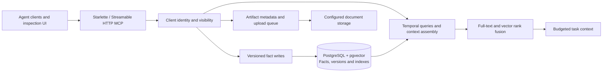

# Nenrin

**A versioned fact store and retrieval service for agents that share project context.**

Nenrin (年輪) gives agents a common place to record decisions, constraints, observations, and next steps. Facts carry source and time information. A replacement creates a new version, so a later agent can recover the current decision and inspect how it changed. Agents ask for a budgeted packet of context at the start of a task and can write back durable findings through the Model Context Protocol (MCP).

This repository is an engineering showcase with system documentation and simplified code examples using synthetic inputs.

## Architecture

## Implementation and roadmap

| Area | Implemented in the private service | Further work |
| --- | --- | --- |
| Fact lifecycle | Version-checked replacement, provenance, two time axes, and expiry from current context. | Extend evidence lineage and downstream review for facts derived from corrected records. |
| Retrieval | Full-text and vector retrieval, reciprocal rank fusion, project routing, optional reranking, and context assembly with an estimated token budget. | Expand reproducible retrieval evaluations on shareable datasets. |
| Access | Scoped credentials, OAuth authorization code with PKCE, project visibility controls, and audit metadata. | Extend coverage as new client and artifact-reading paths are introduced. |
| Artifacts | Linked document metadata, upload staging and retries, and a configurable storage backend. | Evaluate opt-in client collection and measure what it captures. |

[Nenrin's implementation notes](docs/implementation.md) describe concurrent writes, temporal reads, and ranking. [Verification](docs/verification.md) records the checks performed for this showcase. For an application using shared facts, see [Hakoniwa](https://github.com/YOUYUDAWANG/hakoniwa-public).
